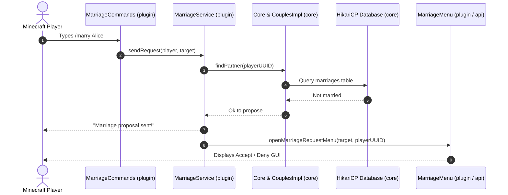

# Architecture Overview

This document details the multi-module Maven structure of **AllianceMarriage**, the responsibilities of each module, runtime component interactions, and the plugin lifecycle.

**English** | [Português (Brasil)](pt-br/architecture-overview.md)

---

## Multi-Module Architecture

AllianceMarriage is divided into four Maven modules:

```
AllianceMarriage (parent)
├── api        -> GUI framework, MenuManager, Preferences, Pagination
├── core       -> Domain models (Couple), dynamic Feature engine, HikariCP Database & Repositories
├── plugin     -> Bukkit runtime: Services, Listeners, Menus, Commands, Config loader
└── test       -> CLI scratchpad for local database and feature validation without Bukkit
```

### Module Responsibilities

| Module | Artifact ID | Responsibilities | Dependencies |
| :--- | :--- | :--- | :--- |
| **`api`** | `AllianceMarriage-api` | Defines reusable contracts for inventory menus (`Menu`, `MenuItem`, `MenuContext`), preferences (`Preference`), and pagination (`Pagination`). Contains no database or couple-specific gameplay logic. | `spigot-api` (provided) |
| **`core`** | `AllianceMarriage-core` | Manages domain entities (`Couple`), the dynamic `Feature<T>` engine, connection pooling (`Database`), and persistence implementations (`CouplesRepository`, `FeatureRepository`). | `HikariCP`, `sqlite-jdbc`, `mysql-connector-j`, `slf4j` |
| **`plugin`** | `AllianceMarriage-plugin` | The runnable Spigot plugin (`Plugin.java`). Orchestrates services (`MarriageService`, `HeartsShopService`), command routing, event listeners, and YAML configuration. | `api`, `core`, `spigot-api` |
| **`test`** | `test` | Internal test application used to verify database queries, feature serialization, and HikariCP pooling without running a Spigot server. | `HikariCP`, `sqlite-jdbc`, `mysql-connector-j` |

---

## Component Interaction Flow

The following diagram shows how player interactions move between modules:



---

## Application Lifecycle

### 1. Startup Sequence (`Plugin#onEnable`)

When the server enables AllianceMarriage:

1. **Core Initialization**:
   - Creates an instance of [`Core.java`](../core/src/main/java/net/joseplay/core/Core.java).
   - Initializes [`Database.java`](../core/src/main/java/net/joseplay/core/storage/Database.java), builds the HikariCP connection pool, and executes `createSchema()` asynchronously to ensure the tables `marriages`, `couples`, and `couples_features` exist.
   - Instantiates repositories: [`FeaturesImpl.java`](../core/src/main/java/net/joseplay/core/storage/impls/FeaturesImpl.java) and [`CouplesImpl.java`](../core/src/main/java/net/joseplay/core/storage/impls/CouplesImpl.java).
   - Calls `core.onEnable()`, which registers the default features: `HeartsFeature` and `PvPFeature`.
2. **Service Setup**:
   - Instantiates [`MarriageService.java`](../plugin/src/main/java/net/joseplay/plugin/service/MarriageService.java) to manage proposals, acceptances, denials, and divorces.
   - Loads shop items from [`hearts-shop.yml`](../plugin/src/main/resources/hearts-shop.yml) using [`HeartsShopLoader.java`](../plugin/src/main/java/net/joseplay/plugin/shop/HeartsShopLoader.java) and configures the `HeartShopLayout`.
   - Starts [`HeartsShopService.java`](../plugin/src/main/java/net/joseplay/plugin/shop/HeartsShopService.java).
3. **Menu & Preferences Setup**:
   - Registers [`MenuManager.java`](../api/src/main/java/net/joseplay/api/menu/MenuManager.java) as an event listener with Bukkit's plugin manager.
   - Registers default couple preferences ([`PVPPrefenrence.java`](../plugin/src/main/java/net/joseplay/plugin/preferences/PVPPrefenrence.java) and [`PointsPreference.java`](../plugin/src/main/java/net/joseplay/plugin/preferences/PointsPreference.java)) into [`PreferencesManager.java`](../api/src/main/java/net/joseplay/api/preferences/PreferencesManager.java).
4. **Command & Listener Registration**:
   - Binds the executor and tab completer for `/marriage`.
   - Registers [`MarriageListeners.java`](../plugin/src/main/java/net/joseplay/plugin/listeners/MarriageListeners.java) to intercept PvP damage between partners and pre-load couple data when a player joins.

### 2. Shutdown Sequence (`Plugin#onDisable`)

When the server stops or restarts:

1. `Core#onDisable()` closes the HikariCP connection pool.
2. Clears the `FeatureRegistry`.
3. Calls `MenuManager#shutdown()`, which iterates over open player menus and closes their inventories to prevent item moving during shutdown.

---

## Concurrency Model

Minecraft's main server loop runs on a single thread. AllianceMarriage handles concurrency using the following boundaries:

- **Database Queries & Updates**: Executed via a dedicated `ExecutorService` (8 threads for MySQL, 1 thread for SQLite) using `CompletableFuture`.
- **In-Memory Caches**: Stored in `ConcurrentHashMap` instances (`coupleMap`, `playerCoupleMap`, `openMenus`).
- **Bukkit API Interactions**: When an asynchronous database query completes and needs to interact with the game (e.g. sending messages, opening inventories, executing console commands), execution is scheduled back onto the main thread via `Bukkit.getScheduler().runTask(plugin, ...)`.
- **Transaction Debounce**: `HeartsShopService` tracks active transactions in a concurrent set (`processingPurchases`) to prevent players from triggering multiple simultaneous purchases before the previous database update completes.
