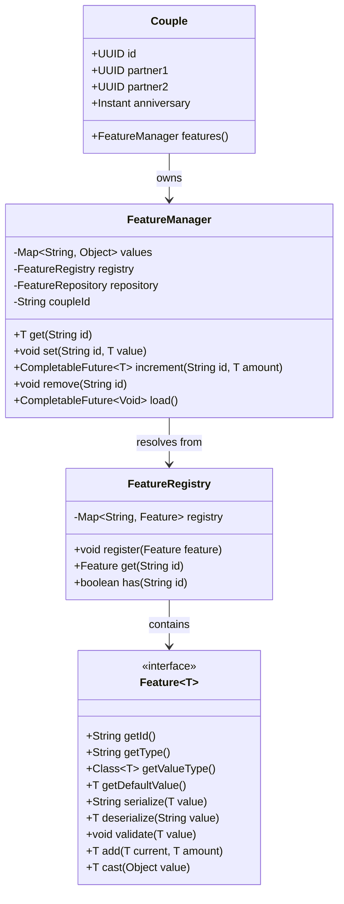

# Features & Attributes System

AllianceMarriage stores dynamic couple attributes as key-value records in the database rather than adding new columns to the `couples` table. This is handled by the **Feature Engine** located in `core` (`net.joseplay.core.feature`).

**English** | [Português (Brasil)](pt-br/features-system.md)

---

## Core Components



---

## Interfaces and Classes

### 1. `Feature<T>`
Located at: [`Feature.java`](../core/src/main/java/net/joseplay/core/feature/Feature.java)

Interface defining an attribute of type `T`:

| Method | Return Type | Description |
| :--- | :--- | :--- |
| `getId()` | `String` | Feature identifier (e.g. `"hearts"`, `"pvp"`). |
| `getType()` | `String` | SQL type used for casting during database updates (`INTEGER`, `BOOLEAN`, `DOUBLE`, `LONG`). |
| `getValueType()` | `Class<T>` | Java class object (`Integer.class`, `Boolean.class`). |
| `getDefaultValue()` | `T` | Value returned if no record exists in database. |
| `serialize(T value)` | `String` | Converts Java object into string for database storage. |
| `deserialize(String str)` | `T` | Converts stored string back into Java type `T`. |
| `validate(T value)` | `void` | Checks value constraints before saving. Throws `IllegalArgumentException` on invalid values. |
| `add(T current, T amount)`| `T` | Optional Java-side addition logic. |
| `cast(Object value)` | `T` | Casts untyped cached objects to `T`. |

---

### 2. `FeatureRegistry`
Located at: [`FeatureRegistry.java`](../core/src/main/java/net/joseplay/core/FeatureRegistry.java)

Stores all registered `Feature<?>` definitions:

```java
FeatureRegistry registry = Core.getInstance().getFeatureRegistry();

// Register a feature
registry.register(new HeartsFeature());

// Lookup
Feature<?> feature = registry.get("hearts");

// Check existence
boolean registered = registry.has("pvp");
```

---

### 3. `FeatureManager`
Located at: [`FeatureManager.java`](../core/src/main/java/net/joseplay/core/feature/FeatureManager.java)

Each [`Couple`](../core/src/main/java/net/joseplay/core/couple/Couple.java) instance holds a `FeatureManager` to interact with its attributes.

#### Reading a Value:
```java
// Returns feature.getDefaultValue() if not present
int hearts = couple.features().get("hearts");
boolean pvpActive = couple.features().get("pvp");
```

#### Writing a Value:
```java
// Updates in-memory map and triggers asynchronous SQL update
couple.features().set("pvp", true);

// Passing null removes the record from database and cache
couple.features().set("pvp", null);
```

#### Atomic Increments:
```java
// Increments directly in the database using SQL addition
couple.features().increment("hearts", 25).thenAccept(newBalance -> {
    player.sendMessage("New balance: " + newBalance);
});

// Atomic subtraction
couple.features().increment("hearts", -50);
```

#### Loading Stored Attributes:
```java
couple.features().load().thenRun(() -> {
    // Attributes from couples_features table are now populated into cache
});
```

---

## Built-in Features

AllianceMarriage includes two default features:

### 1. `HeartsFeature`
Located at: [`HeartsFeature.java`](../core/src/main/java/net/joseplay/core/feature/defaults/HeartsFeature.java)

- **ID**: `"hearts"`
- **Type**: `"INTEGER"`
- **Default Value**: `0`
- **Validation**: Enforces non-negative values (`value >= 0`).

### 2. `PvPFeature`
Located at: [`PvPFeature.java`](../core/src/main/java/net/joseplay/core/feature/defaults/PvPFeature.java)

- **ID**: `"pvp"`
- **Type**: `"BOOLEAN"`
- **Default Value**: `false` (PvP disabled between partners by default).

---

## Example: Implementing a Custom Feature

The following example defines a numerical `"level"` feature starting at 1:

```java
package net.joseplay.example;

import net.joseplay.core.feature.Feature;

public class LevelFeature implements Feature<Integer> {

    @Override
    public String getId() {
        return "level";
    }

    @Override
    public String getType() {
        return "INTEGER"; // Enables atomic database increment
    }

    @Override
    public Class<Integer> getValueType() {
        return Integer.class;
    }

    @Override
    public Integer getDefaultValue() {
        return 1;
    }

    @Override
    public String serialize(Integer value) {
        return String.valueOf(value);
    }

    @Override
    public Integer deserialize(String value) {
        try {
            return Integer.parseInt(value);
        } catch (NumberFormatException e) {
            return getDefaultValue();
        }
    }

    @Override
    public void validate(Integer value) {
        if (value < 1) {
            throw new IllegalArgumentException("Level must be >= 1");
        }
    }

    @Override
    public Integer add(Integer current, Integer amount) {
        return current + amount;
    }
}
```

### Registration:
```java
Core.getInstance().getFeatureRegistry().register(new LevelFeature());
```

### Usage:
```java
Couple couple = marriageService.getCouple(player.getUniqueId()).join().orElse(null);
if (couple != null) {
    int currentLevel = couple.features().get("level");
    couple.features().increment("level", 1);
}
```
