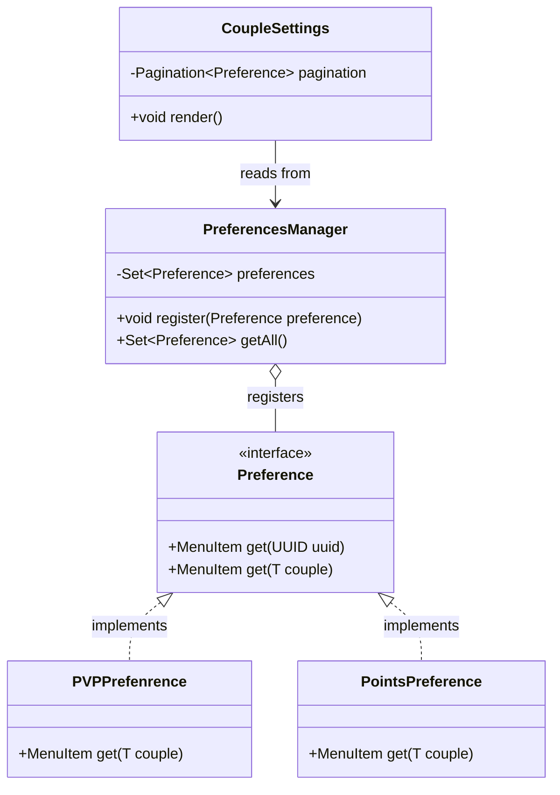

# Preferences API

The **Preferences API** allows developers to register custom settings items in the **Couple Settings GUI** (`/marriage couple`) without modifying existing menu code.

**English** | [Português (Brasil)](pt-br/preferences-api.md)

---

## Core Interfaces & Classes



---

### 1. `Preference` (Interface)
Located at: [`Preference.java`](../api/src/main/java/net/joseplay/api/preferences/Preference.java)

Defines methods to produce a clickable [`MenuItem`](../api/src/main/java/net/joseplay/api/menu/MenuItem.java) for a given player or couple:

```java
package net.joseplay.api.preferences;

import net.joseplay.api.menu.MenuItem;
import java.util.UUID;

public interface Preference {
    MenuItem get(UUID uuid);

    <T> MenuItem get(T couple);
}
```

---

### 2. `PreferencesManager`
Located at: [`PreferencesManager.java`](../api/src/main/java/net/joseplay/api/preferences/PreferencesManager.java)

Maintains the active set of registered `Preference` instances:

```java
PreferencesManager manager = Plugin.getInstance().getPreferencesManager();

// Register a preference
manager.register(new PVPPrefenrence());

// Retrieve registered set
Set<Preference> preferences = manager.getAll();
```

---

## Default Implementations

AllianceMarriage registers two built-in preferences:

### 1. `PVPPrefenrence`
Located at: [`PVPPrefenrence.java`](../plugin/src/main/java/net/joseplay/plugin/preferences/PVPPrefenrence.java)

Renders a diamond sword icon displaying current PvP status and toggling `couple.features().set("pvp", !pvp)` on click.

### 2. `PointsPreference`
Located at: [`PointsPreference.java`](../plugin/src/main/java/net/joseplay/plugin/preferences/PointsPreference.java)

Renders a diamond displaying the current Hearts balance and calling `couple.features().increment("hearts", 10)` on click.

---

## Example: Creating a Custom Preference

The following example implements a toggle button for an imaginary `"shared_xp"` feature:

```java
package net.joseplay.example;

import net.joseplay.api.menu.MenuItem;
import net.joseplay.api.preferences.Preference;
import net.joseplay.core.couple.Couple;
import net.joseplay.plugin.util.ItemBuilder;
import org.bukkit.Material;
import org.bukkit.inventory.ItemStack;

import java.util.UUID;

public class SharedXpPreference implements Preference {

    @Override
    public MenuItem get(UUID uuid) {
        return MenuItem.of(new ItemStack(Material.BARRIER));
    }

    @Override
    public <T> MenuItem get(T c) {
        Couple couple = (Couple) c;
        if (couple == null) {
            return MenuItem.of(new ItemStack(Material.BARRIER));
        }

        boolean enabled = couple.features().has("shared_xp") 
                && (boolean) couple.features().get("shared_xp");

        ItemStack icon = ItemBuilder.of(Material.EXPERIENCE_BOTTLE)
                .name("&aShared Experience")
                .lore(
                    "&7Toggle sharing XP with partner.",
                    "&7Status: " + (enabled ? "&aEnabled" : "&cDisabled")
                )
                .build();

        return new MenuItem(icon, context -> {
            couple.features().set("shared_xp", !enabled);
            context.getPlayer().sendMessage("Shared XP updated.");
        });
    }
}
```

### Registration:
```java
Plugin.getInstance().getPreferencesManager().register(new SharedXpPreference());
```

Registered items will be displayed inside the [`CoupleSettings.java`](../plugin/src/main/java/net/joseplay/plugin/menu/CoupleSettings.java) GUI when a player runs `/marriage couple`.
