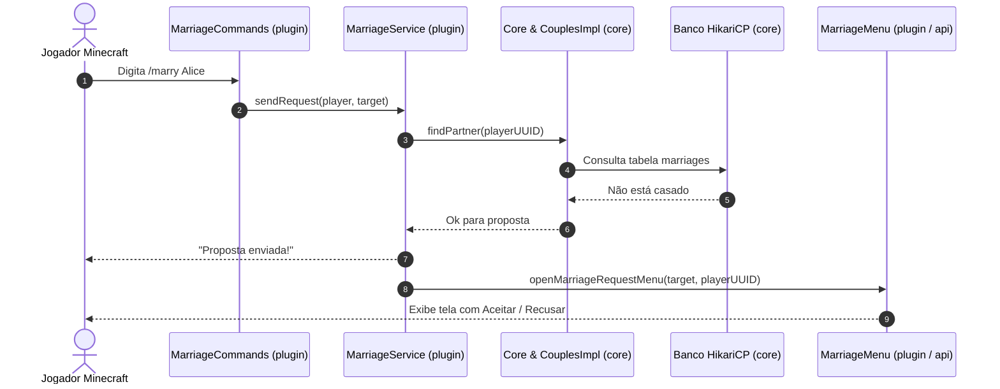

# Visão Geral da Arquitetura

Este documento descreve a divisão dos módulos Maven do **AllianceMarriage**, a responsabilidade de cada camada, o fluxo de execução entre os componentes e o ciclo de vida do plugin.

[English](../architecture-overview.md) | **Português (Brasil)**

---

## Estrutura Multi-Módulos

O AllianceMarriage é composto por quatro módulos Maven:

```
AllianceMarriage (parent)
├── api        -> Framework de GUI, MenuManager, Preferences, Pagination
├── core       -> Entidade Couple, motor dinâmico de Features, banco HikariCP e Repositories
├── plugin     -> Runtime do Spigot: Services, Listeners, Menus, Commands, carregador YAML
└── test       -> Aplicação CLI para testes de gravação e serialização de banco sem Bukkit
```

### Responsabilidades por Módulo

| Módulo | Artifact ID | Responsabilidades | Dependências |
| :--- | :--- | :--- | :--- |
| **`api`** | `AllianceMarriage-api` | Define contratos para inventários de baú (`Menu`, `MenuItem`, `MenuContext`), preferências (`Preference`) e utilitário de paginação (`Pagination`). Não referencia banco de dados ou regras de casamento. | `spigot-api` (provided) |
| **`core`** | `AllianceMarriage-core` | Gerencia o modelo `Couple`, o motor de atributos `Feature<T>`, o pool HikariCP (`Database`) e as implementações de persistência (`CouplesRepository`, `FeatureRepository`). | `HikariCP`, `sqlite-jdbc`, `mysql-connector-j`, `slf4j` |
| **`plugin`** | `AllianceMarriage-plugin` | O plugin Spigot executável (`Plugin.java`). Registra comandos, listeners de eventos, serviços (`MarriageService`, `HeartsShopService`) e menus concretos. | `api`, `core`, `spigot-api` |
| **`test`** | `test` | Módulo interno para validação isolada de banco e atributos sem inicializar o servidor Spigot. | `HikariCP`, `sqlite-jdbc`, `mysql-connector-j` |

---

## Fluxo de Interação entre Componentes

O diagrama a seguir exibe o caminho percorrido por uma ação do jogador:



---

## Ciclo de Vida do Plugin

### 1. Inicialização (`Plugin#onEnable`)

Durante a ativação do plugin pelo servidor:

1. **Inicialização do Core**:
   - Cria a instância de [`Core.java`](../../core/src/main/java/net/joseplay/core/Core.java).
   - Inicializa [`Database.java`](../../core/src/main/java/net/joseplay/core/storage/Database.java), constrói o pool HikariCP e executa `createSchema()` assincronamente para certificar que as tabelas `marriages`, `couples` e `couples_features` existam.
   - Instancia os repositórios: [`FeaturesImpl.java`](../../core/src/main/java/net/joseplay/core/storage/impls/FeaturesImpl.java) e [`CouplesImpl.java`](../../core/src/main/java/net/joseplay/core/storage/impls/CouplesImpl.java).
   - Executa `core.onEnable()`, registrando as features nativas: `HeartsFeature` e `PvPFeature`.
2. **Serviços**:
   - Cria [`MarriageService.java`](../../plugin/src/main/java/net/joseplay/plugin/service/MarriageService.java) para controlar pedidos, aceites, recusas e divórcios.
   - Carrega itens do arquivo [`hearts-shop.yml`](../../plugin/src/main/resources/hearts-shop.yml) usando [`HeartsShopLoader.java`](../../plugin/src/main/java/net/joseplay/plugin/shop/HeartsShopLoader.java) e configura o `HeartShopLayout`.
   - Inicializa [`HeartsShopService.java`](../../plugin/src/main/java/net/joseplay/plugin/shop/HeartsShopService.java).
3. **Menus e Preferências**:
   - Registra [`MenuManager.java`](../../api/src/main/java/net/joseplay/api/menu/MenuManager.java) como ouvinte de inventários no Bukkit.
   - Registra as preferências nativas ([`PVPPrefenrence.java`](../../plugin/src/main/java/net/joseplay/plugin/preferences/PVPPrefenrence.java) e [`PointsPreference.java`](../../plugin/src/main/java/net/joseplay/plugin/preferences/PointsPreference.java)) no [`PreferencesManager.java`](../../api/src/main/java/net/joseplay/api/preferences/PreferencesManager.java).
4. **Comandos e Listeners**:
   - Registra o executor e tab-completer do comando `/marriage`.
   - Registra [`MarriageListeners.java`](../../plugin/src/main/java/net/joseplay/plugin/listeners/MarriageListeners.java) para controle de PvP entre cônjuges e pré-carga de dados no login.

### 2. Desligamento (`Plugin#onDisable`)

Quando o servidor é encerrado ou reiniciado:

1. `Core#onDisable()` fecha as conexões do pool HikariCP.
2. Limpa o `FeatureRegistry`.
3. Executa `MenuManager#shutdown()`, fechando todos os inventários abertos para impedir manipulação indevida de itens durante o encerramento.

---

## Modelo de Concorrência

O servidor Minecraft roda sua lógica principal em uma única thread. O AllianceMarriage divide o processamento da seguinte forma:

- **Operações de Banco**: Executadas em um `ExecutorService` próprio (8 threads para MySQL, 1 para SQLite) com `CompletableFuture`.
- **Caches em Memória**: Estruturados com `ConcurrentHashMap` (`coupleMap`, `playerCoupleMap`, `openMenus`).
- **Retorno à Thread do Bukkit**: Quando uma resposta assíncrona precisa modificar o jogo (enviar mensagens no chat, abrir inventários ou disparar comandos de console), a execução é reagendada na thread do servidor via `Bukkit.getScheduler().runTask(plugin, ...)`.
- **Controle de Transação**: O `HeartsShopService` usa um conjunto concorrente (`processingPurchases`) para impedir que um jogador envie múltiplas compras simultâneas enquanto a operação SQL anterior ainda está em andamento.
