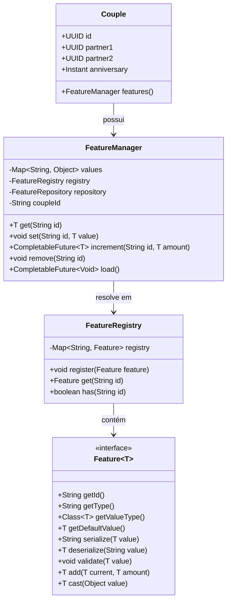

# Sistema de Recursos e Atributos

O AllianceMarriage armazena atributos de casais em formato chave-valor no banco de dados em vez de adicionar colunas fixas na tabela `couples`. O gerenciamento é feito pelo motor de **Features** em `core` (`net.joseplay.core.feature`).

[English](../features-system.md) | **Português (Brasil)**

---

## Componentes



---

## Interfaces e Classes

### 1. `Feature<T>`
Localizado em: [`Feature.java`](../../core/src/main/java/net/joseplay/core/feature/Feature.java)

Contrato que define um atributo do tipo `T`:

| Método | Retorno | Descrição |
| :--- | :--- | :--- |
| `getId()` | `String` | Identificador único (ex.: `"hearts"`, `"pvp"`). |
| `getType()` | `String` | Tipo SQL usado para casting nos incrementos (`INTEGER`, `BOOLEAN`, `DOUBLE`, `LONG`). |
| `getValueType()` | `Class<T>` | Objeto de classe Java (`Integer.class`, `Boolean.class`). |
| `getDefaultValue()` | `T` | Valor padrão quando não houver registro no banco. |
| `serialize(T value)` | `String` | Converte o objeto em texto para gravação no SQL. |
| `deserialize(String str)` | `T` | Converte o texto do banco de volta para `T`. |
| `validate(T value)` | `void` | Valida restrições do valor. Lança `IllegalArgumentException` caso inválido. |
| `add(T current, T amount)`| `T` | Lógica opcional de soma na camada Java. |
| `cast(Object value)` | `T` | Converte com segurança objetos brutos em cache para `T`. |

---

### 2. `FeatureRegistry`
Localizado em: [`FeatureRegistry.java`](../../core/src/main/java/net/joseplay/core/FeatureRegistry.java)

Armazena as definições de `Feature<?>` registradas:

```java
FeatureRegistry registry = Core.getInstance().getFeatureRegistry();

// Registro
registry.register(new HeartsFeature());

// Consulta
Feature<?> feature = registry.get("hearts");

// Checagem
boolean existe = registry.has("pvp");
```

---

### 3. `FeatureManager`
Localizado em: [`FeatureManager.java`](../../core/src/main/java/net/joseplay/core/feature/FeatureManager.java)

Cada objeto [`Couple`](../../core/src/main/java/net/joseplay/core/couple/Couple.java) possui um `FeatureManager` para manipular seus atributos.

#### Leitura:
```java
// Retorna defaultValue caso não exista no banco ou cache
int hearts = couple.features().get("hearts");
boolean pvp = couple.features().get("pvp");
```

#### Gravação:
```java
// Salva no mapa em memória e agenda atualização assíncrona no banco
couple.features().set("pvp", true);

// Passar null remove o registro do banco e do cache
couple.features().set("pvp", null);
```

#### Incremento Atômico:
```java
// Adição executada diretamente no SQL
couple.features().increment("hearts", 25).thenAccept(novoSaldo -> {
    player.sendMessage("Novo saldo: " + novoSaldo);
});

// Débito atômico
couple.features().increment("hearts", -50);
```

#### Carregar Atributos Salvos:
```java
couple.features().load().thenRun(() -> {
    // Registros de couples_features carregados para o cache
});
```

---

## Features Padrão

### 1. `HeartsFeature`
Localizado em: [`HeartsFeature.java`](../../core/src/main/java/net/joseplay/core/feature/defaults/HeartsFeature.java)

- **ID**: `"hearts"`
- **Tipo**: `"INTEGER"`
- **Padrão**: `0`
- **Validação**: Lança exceção se o valor for negativo (`value < 0`).

### 2. `PvPFeature`
Localizado em: [`PvPFeature.java`](../../core/src/main/java/net/joseplay/core/feature/defaults/PvPFeature.java)

- **ID**: `"pvp"`
- **Tipo**: `"BOOLEAN"`
- **Padrão**: `false` (combate entre parceiros desativado).

---

## Exemplo: Implementando uma Feature Customizada

Exemplo de uma feature numérica de nível de casal (`"level"`):

```java
package net.joseplay.exemplo;

import net.joseplay.core.feature.Feature;

public class LevelFeature implements Feature<Integer> {

    @Override
    public String getId() {
        return "level";
    }

    @Override
    public String getType() {
        return "INTEGER"; // Habilita incremento atômico no SQL
    }

    @Override
    public Class<Integer> getValueType() {
        return Integer.class;
    }

    @Override
    public Integer getDefaultValue() {
        return 1;
    }

    @Override
    public String serialize(Integer value) {
        return String.valueOf(value);
    }

    @Override
    public Integer deserialize(String value) {
        try {
            return Integer.parseInt(value);
        } catch (NumberFormatException e) {
            return getDefaultValue();
        }
    }

    @Override
    public void validate(Integer value) {
        if (value < 1) {
            throw new IllegalArgumentException("Nível deve ser >= 1");
        }
    }

    @Override
    public Integer add(Integer current, Integer amount) {
        return current + amount;
    }
}
```

### Registro:
```java
Core.getInstance().getFeatureRegistry().register(new LevelFeature());
```

### Uso:
```java
Couple couple = marriageService.getCouple(player.getUniqueId()).join().orElse(null);
if (couple != null) {
    int nivel = couple.features().get("level");
    couple.features().increment("level", 1);
}
```
