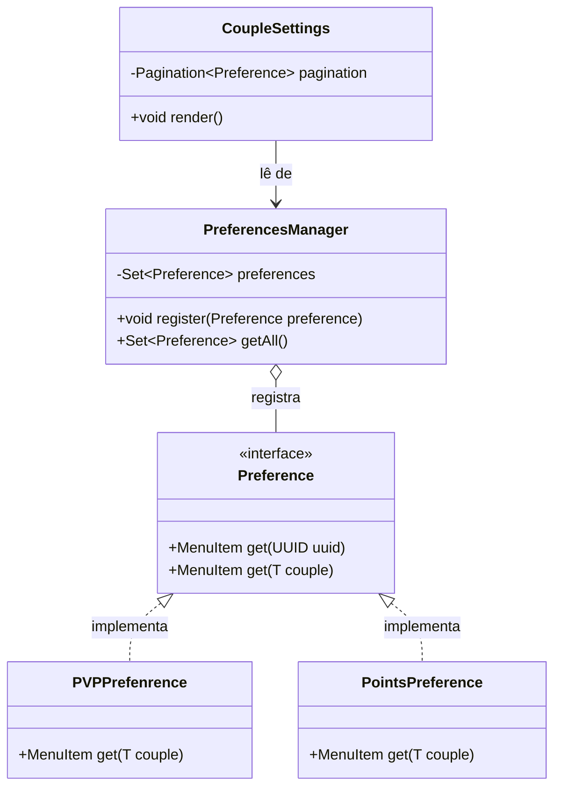

# API de Preferências

A **API de Preferências** permite cadastrar itens de configuração customizados na tela de **Ajustes do Casal** (`/marriage couple`) sem modificar as classes de menu existentes.

[English](../preferences-api.md) | **Português (Brasil)**

---

## Estrutura de Classes



---

### 1. `Preference` (Interface)
Localizado em: [`Preference.java`](../../api/src/main/java/net/joseplay/api/preferences/Preference.java)

Define os métodos que geram um [`MenuItem`](../../api/src/main/java/net/joseplay/api/menu/MenuItem.java) interativo para o jogador ou casal:

```java
package net.joseplay.api.preferences;

import net.joseplay.api.menu.MenuItem;
import java.util.UUID;

public interface Preference {
    MenuItem get(UUID uuid);

    <T> MenuItem get(T couple);
}
```

---

### 2. `PreferencesManager`
Localizado em: [`PreferencesManager.java`](../../api/src/main/java/net/joseplay/api/preferences/PreferencesManager.java)

Mantém o conjunto de instâncias de `Preference` ativas:

```java
PreferencesManager manager = Plugin.getInstance().getPreferencesManager();

// Registro
manager.register(new PVPPrefenrence());

// Listagem
Set<Preference> preferencias = manager.getAll();
```

---

## Implementações Nativas

O AllianceMarriage inclui duas preferências pré-cadastradas:

### 1. `PVPPrefenrence`
Localizado em: [`PVPPrefenrence.java`](../../plugin/src/main/java/net/joseplay/plugin/preferences/PVPPrefenrence.java)

Exibe uma espada de diamante refletindo o status atual do PvP e executa `couple.features().set("pvp", !pvp)` ao receber cliques.

### 2. `PointsPreference`
Localizado em: [`PointsPreference.java`](../../plugin/src/main/java/net/joseplay/plugin/preferences/PointsPreference.java)

Exibe um diamante com o saldo de Hearts e chama `couple.features().increment("hearts", 10)` ao ser acionado.

---

## Exemplo: Criando uma Preferência Customizada

Exemplo de botão para alternar uma feature hipotética `"shared_xp"`:

```java
package net.joseplay.exemplo;

import net.joseplay.api.menu.MenuItem;
import net.joseplay.api.preferences.Preference;
import net.joseplay.core.couple.Couple;
import net.joseplay.plugin.util.ItemBuilder;
import org.bukkit.Material;
import org.bukkit.inventory.ItemStack;

import java.util.UUID;

public class SharedXpPreference implements Preference {

    @Override
    public MenuItem get(UUID uuid) {
        return MenuItem.of(new ItemStack(Material.BARRIER));
    }

    @Override
    public <T> MenuItem get(T c) {
        Couple couple = (Couple) c;
        if (couple == null) {
            return MenuItem.of(new ItemStack(Material.BARRIER));
        }

        boolean ativado = couple.features().has("shared_xp") 
                && (boolean) couple.features().get("shared_xp");

        ItemStack icone = ItemBuilder.of(Material.EXPERIENCE_BOTTLE)
                .name("&aXP Compartilhado")
                .lore(
                    "&7Divide o XP ganho com o parceiro.",
                    "&7Status: " + (ativado ? "&aAtivado" : "&cDesativado")
                )
                .build();

        return new MenuItem(icone, context -> {
            couple.features().set("shared_xp", !ativado);
            context.getPlayer().sendMessage("XP Compartilhado atualizado.");
        });
    }
}
```

### Registro:
```java
Plugin.getInstance().getPreferencesManager().register(new SharedXpPreference());
```

Os itens cadastrados são renderizados na interface de baú [`CoupleSettings.java`](../../plugin/src/main/java/net/joseplay/plugin/menu/CoupleSettings.java) quando o jogador usa `/marriage couple`.
