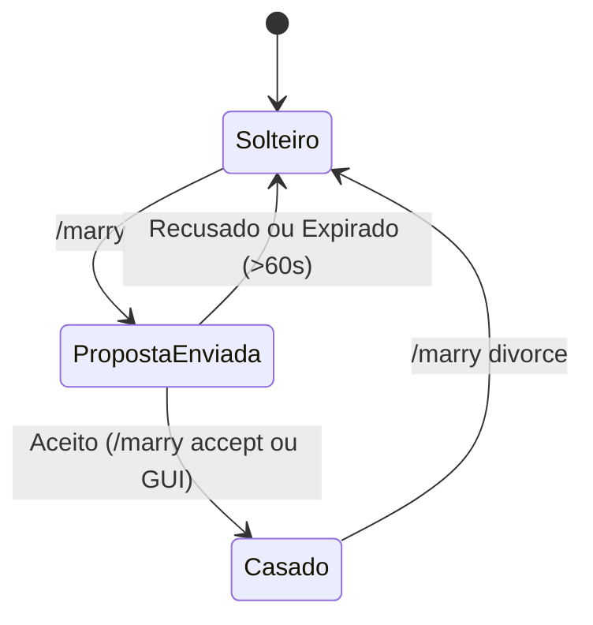

# Serviços e Regras de Negócio

O módulo `plugin` coordena mudanças de estado no relacionamento, ciclo de vida de propostas, transações da loja e interceptação de combate.

[English](../services-and-business-logic.md) | **Português (Brasil)**

---

## Serviço de Casamentos: `MarriageService`
Localizado em: [`MarriageService.java`](../../plugin/src/main/java/net/joseplay/plugin/service/MarriageService.java)

Gerencia criação de propostas, aceites, recusas e divórcios.



### 1. Registro de Proposta (`MarriageRequest`)
Propostas são registradas em um record com tempo de expiração fixado em 60 segundos:
```java
public record MarriageRequest(UUID requester, UUID target, long timestamp) {
    public boolean isExpired() {
        return System.currentTimeMillis() - timestamp > 60_000L;
    }
}
```
Propostas ativas ficam armazenadas em `ConcurrentHashMap<UUID, MarriageRequest> pendingRequests`.

### 2. Fluxo de Proposta (`sendRequest`)
Quando o jogador A envia uma proposta ao jogador B:
1. Valida se o jogador não está propondo casamento a si mesmo (`requester.getUniqueId().equals(target.getUniqueId())`).
2. Verifica no banco se o solicitante já possui cônjuge.
3. Verifica se o destinatário já possui cônjuge.
4. Grava o `MarriageRequest` mapeado ao UUID do jogador B.
5. Emite mensagens no chat e abre a tela [`MarriageRequestMenu.java`](../../plugin/src/main/java/net/joseplay/plugin/menu/MarriageRequestMenu.java) para o jogador B.

### 3. Aceitação (`acceptRequest`)
1. Confirma se o pedido existe, se o autor confere e se os 60 segundos não foram ultrapassados.
2. Invoca `CouplesRepository#marryPlayer`, gravando as linhas nas tabelas `marriages` e `couples`.
3. Reagenda a notificação dos jogadores para a thread principal do Bukkit.

### 4. Divórcio (`divorce`)
1. Invoca `CouplesRepository#divorcePlayer(playerUUID)`.
2. Remove registros da tabela `marriages` nos dois sentidos.
3. Evita que dados residuais permaneçam no cache do `CouplesImpl`.
4. Emite mensagem de confirmação para o jogador.

---

## Serviço da Loja Hearts: `HeartsShopService`
Localizado em: [`HeartsShopService.java`](../../plugin/src/main/java/net/joseplay/plugin/shop/HeartsShopService.java)

Executa a compra de itens na loja consumindo o saldo conjunto de Hearts do casal.

### Controle de Debounce Concorrente (`processingPurchases`)
Para evitar que múltiplos cliques disparem compras simultâneas enquanto o banco ainda processa a transação, compras ativas são marcadas em um conjunto concorrente:

```java
private final Set<UUID> processingPurchases = ConcurrentHashMap.newKeySet();
```

Ao iniciar uma compra:
```java
if (!processingPurchases.add(playerId)) {
    player.sendMessage(ChatColor.RED + "Aguarde, sua compra anterior ainda está em processamento.");
    return CompletableFuture.completedFuture(false);
}
```
A trava é removida em blocos `finally` ou no tratamento de erro da operação.

### Etapas da Compra (`purchase`):
1. **Verificação de Vínculo**: Confirma se o jogador possui um casal ativo.
2. **Checagem de Saldo**: Valida se `currentHearts >= item.getPrice()`.
3. **Débito Atômico**: Executa `couple.features().increment("hearts", -item.getPrice())`.
4. **Execução de Comandos**: Dispara os comandos de console cadastrados, substituindo os placeholders:
   - `%player%`: Nome do jogador.
   - `%uuid%`: UUID do jogador.
   - `%price%`: Preço pago em Hearts.
   - `%item%`: Chave do item na configuração.
   - `%hearts%`: Saldo restante após o débito.

---

## Ouvintes de Eventos: `MarriageListeners`
Localizado em: [`MarriageListeners.java`](../../plugin/src/main/java/net/joseplay/plugin/listeners/MarriageListeners.java)

### 1. Interceptação de PvP (`EntityDamageByEntityEvent`)
Quando um jogador ataca outro:
1. Localiza a entidade `Couple` do atacante no cache.
2. Valida se a entidade atacada é o parceiro matrimonial.
3. Verifica a preferência de PvP do casal: `couple.features().get("pvp")`.
4. Caso o PvP esteja desativado, cancela o evento (`e.setCancelled(true)`) e envia aviso no chat.

### 2. Carga Preventiva no Login (`PlayerJoinEvent`)
Quando um jogador conecta ao servidor:
- Executa `CouplesRepository#findPartner` e `CouplesRepository#find` assincronamente.
- Preenche os dados do casal e suas features na memória antes que o jogador abra qualquer menu.
