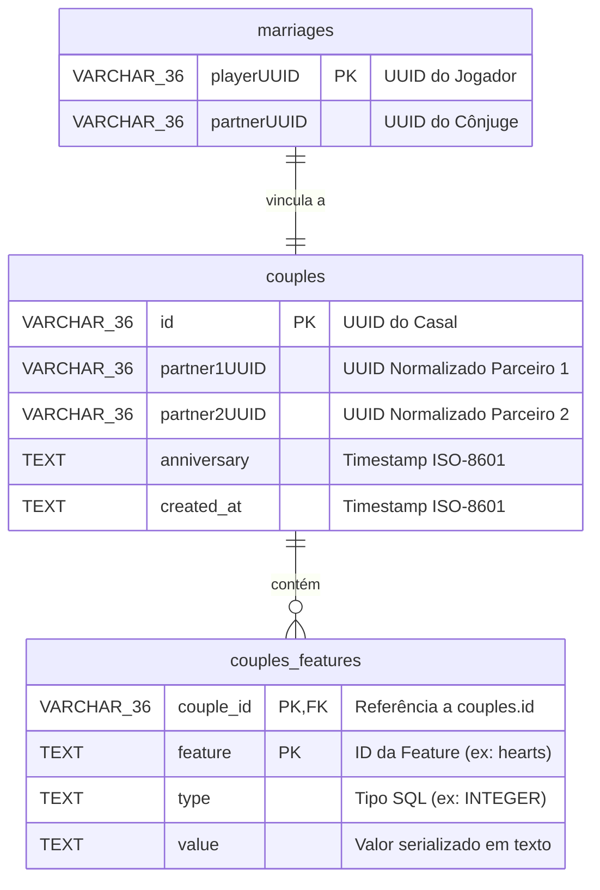

# Camada de Armazenamento e Banco de Dados

A camada de armazenamento do **AllianceMarriage** gerencia conexões via **HikariCP** e implementa persistência assíncrona para relações de casamento e atributos dinâmicos. Suporta **SQLite** e **MySQL**.

[English](../storage-and-database.md) | **Português (Brasil)**

---

## Esquemas do Banco de Dados

O método `Database#createSchema()` valida e cria três tabelas relacionais na inicialização:



### Tabelas:
1. **`marriages`**: Registra mapeamentos 1:1. Associa o UUID de cada jogador ao UUID do seu cônjuge.
2. **`couples`**: Registro da união matrimonial. Contém data de aniversário, data de criação e impõe `UNIQUE(partner1UUID, partner2UUID)`.
3. **`couples_features`**: Armazena atributos dinâmicos em formato chave-valor vinculados ao `couple_id`.

---

## Gerenciador de Conexões: `Database`
Localizado em: [`Database.java`](../../core/src/main/java/net/joseplay/core/storage/Database.java)

Gerencia a instância de **HikariDataSource** e encapsula a execução assíncrona de consultas.

### Configuração SQLite vs MySQL:
- Quando `PluginSettings#mysql()` retorna `false`:
  - Conecta ao arquivo `plugins/AllianceMarriage/marriage.db` usando o driver SQLite (`org.sqlite.JDBC`).
  - O pool é configurado com tamanho máximo `1` para evitar conflito de locks de arquivo.
- Quando `PluginSettings#mysql()` retorna `true`:
  - Conecta ao servidor remoto via `com.mysql.cj.jdbc.Driver` com host, porta, usuário e senha definidos.
  - Define o tamanho do pool como `8`.

### Métodos Principais:

#### 1. Execução de Consultas (`executeQueryAsync`):
```java
String sql = "SELECT anniversary FROM couples WHERE id = ?";

CompletableFuture<Optional<Instant>> future = database.executeQueryAsync(
    sql,
    resultSet -> {
        if (!resultSet.next()) {
            return Optional.empty();
        }
        return Optional.of(Instant.parse(resultSet.getString("anniversary")));
    },
    coupleId.toString()
);
```

#### 2. Execução de Atualizações (`executeUpdateAsync`):
```java
String sql = "UPDATE couples SET anniversary = ? WHERE id = ?";

database.executeUpdateAsync(sql, Instant.now().toString(), coupleId.toString());
```

---

## Repositório de Casais: `CouplesImpl`
Localizado em:
- Interface: [`CouplesRepository.java`](../../core/src/main/java/net/joseplay/core/storage/CouplesRepository.java)
- Implementação: [`CouplesImpl.java`](../../core/src/main/java/net/joseplay/core/storage/impls/CouplesImpl.java)

`CouplesImpl` implementa cache em memória para reduzir consultas ao banco de dados durante a gameplay.

### Estruturas de Cache:
```java
// Mapeia coupleId -> Instância de Couple
private final Map<UUID, Couple> coupleMap = new ConcurrentHashMap<>();

// Mapeia playerUUID -> coupleId
private final Map<UUID, UUID> playerCoupleMap = new ConcurrentHashMap<>();
```

### Normalização de Parceiros:
Para evitar registros duplicados onde o jogador A é parceiro 1 em uma linha e parceiro 2 em outra, os UUIDs são ordenados alfabeticamente:

```java
private UUID[] normalize(UUID partner1, UUID partner2) {
    if (partner1.toString().compareTo(partner2.toString()) <= 0) {
        return new UUID[]{partner1, partner2};
    }
    return new UUID[]{partner2, partner1};
}
```
Independentemente de quem iniciou o pedido, o `partner1` sempre receberá o menor UUID em formato String, garantindo uma única linha por casal.

---

## Repositório de Features: `FeaturesImpl`
Localizado em: [`FeaturesImpl.java`](../../core/src/main/java/net/joseplay/core/storage/impls/FeaturesImpl.java)

Responsável por persistir dados na tabela `couples_features`.

### Incrementos Atômicos via SQL:
Ao alterar valores numéricos (`INTEGER`, `LONG`, `DOUBLE`), `FeaturesImpl` executa um comando SQL de adição direta:

#### MySQL:
```sql
INSERT INTO couples_features (couple_id, feature, type, value)
VALUES (?, ?, ?, ?)
ON DUPLICATE KEY UPDATE
    type = VALUES(type),
    value = CAST(couples_features.value AS SIGNED) + CAST(VALUES(value) AS SIGNED);
```

#### SQLite:
```sql
INSERT INTO couples_features (couple_id, feature, type, value)
VALUES (?, ?, ?, ?)
ON CONFLICT(couple_id, feature)
DO UPDATE SET
    type = excluded.type,
    value = CAST(couples_features.value AS INTEGER) + CAST(excluded.value AS INTEGER);
```

Após a operação ser concluída no banco, o novo valor é lido e atualizado no mapa local em memória.

---

## Recomendações de Uso

1. **Evite Bloqueios na Thread Principal**:
   Não chame `.join()` ou `.get()` em métodos assíncronos a partir da thread do Spigot. Trate o resultado com `thenAccept` ou `thenCompose`:
   ```java
   couplesRepository.find(uuid1, uuid2).thenAccept(optionalCouple -> {
       // Callback executado quando o banco responder
   });
   ```

2. **Reagende Operações no Bukkit**:
   Ao interagir com o jogador após uma resposta do banco, envie a ação para a thread do servidor:
   ```java
   couplesRepository.marryPlayer(p1, p2).thenAccept(result -> {
       Bukkit.getScheduler().runTask(plugin, () -> {
           Player player = Bukkit.getPlayer(p1);
           if (player != null) {
               player.sendMessage("Casamento registrado.");
           }
       });
   });
   ```
