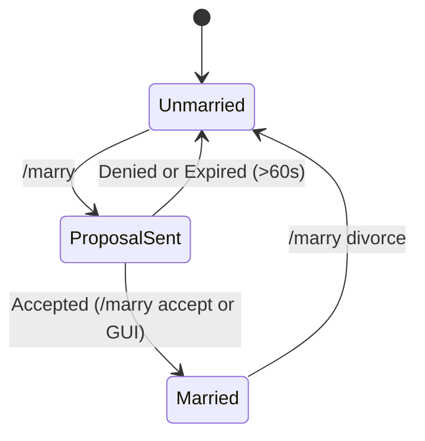

# Services & Business Logic

The `plugin` module coordinates relationship transitions, proposal lifetimes, shop transactions, and combat damage interception.

**English** | [Português (Brasil)](pt-br/services-and-business-logic.md)

---

## Marriage Service: `MarriageService`
Located at: [`MarriageService.java`](../plugin/src/main/java/net/joseplay/plugin/service/MarriageService.java)

Manages proposal states, acceptance, denial, and divorce workflows.



### 1. Proposal Record (`MarriageRequest`)
Proposals are tracked using an immutable record with a 60-second expiration check:
```java
public record MarriageRequest(UUID requester, UUID target, long timestamp) {
    public boolean isExpired() {
        return System.currentTimeMillis() - timestamp > 60_000L;
    }
}
```
Active requests are stored in a `ConcurrentHashMap<UUID, MarriageRequest> pendingRequests`.

### 2. Proposal Flow (`sendRequest`)
When player A sends a proposal to player B:
1. Validates that player A is not marrying themselves (`requester.getUniqueId().equals(target.getUniqueId())`).
2. Checks via `CouplesRepository#findPartner` whether player A is already married.
3. Checks whether player B is already married.
4. Stores the `MarriageRequest` mapped to player B's UUID.
5. Sends chat messages and opens [`MarriageRequestMenu.java`](../plugin/src/main/java/net/joseplay/plugin/menu/MarriageRequestMenu.java) for player B.

### 3. Accepting Proposals (`acceptRequest`)
1. Confirms the proposal exists, matches the expected requester, and has not passed the 60-second timeout.
2. Invokes `CouplesRepository#marryPlayer`, writing records to the `marriages` and `couples` tables.
3. Reschedules to the main thread to notify players.

### 4. Divorce (`divorce`)
1. Calls `CouplesRepository#divorcePlayer(playerUUID)`.
2. Deletes records from the `marriages` table in both directions.
3. Evicts the cached couple from `CouplesImpl`.
4. Sends a confirmation message to the player.

---

## Hearts Shop Service: `HeartsShopService`
Located at: [`HeartsShopService.java`](../plugin/src/main/java/net/joseplay/plugin/shop/HeartsShopService.java)

Handles item purchases in the Hearts Shop using the couple's shared balance.

### Debounce Concurrency Guard (`processingPurchases`)
To prevent concurrent requests from executing duplicate purchases while a database query is in-flight, active purchases are tracked in a concurrent set:

```java
private final Set<UUID> processingPurchases = ConcurrentHashMap.newKeySet();
```

When a purchase begins:
```java
if (!processingPurchases.add(playerId)) {
    player.sendMessage(ChatColor.RED + "Please wait, your previous purchase is still processing.");
    return CompletableFuture.completedFuture(false);
}
```
The lock is cleared in `finally` blocks or exception handlers upon completion.

### Transaction Steps (`purchase`):
1. **Relationship Check**: Validates that the player has an active couple record.
2. **Balance Verification**: Checks if `currentHearts >= item.getPrice()`.
3. **Atomic Deduction**: Calls `couple.features().increment("hearts", -item.getPrice())`.
4. **Command Execution**: Dispatches configured console commands on the server thread, substituting placeholders:
   - `%player%`: Username.
   - `%uuid%`: Player UUID.
   - `%price%`: Hearts price paid.
   - `%item%`: Item configuration ID.
   - `%hearts%`: Remaining Hearts balance.

---

## Event Listeners: `MarriageListeners`
Located at: [`MarriageListeners.java`](../plugin/src/main/java/net/joseplay/plugin/listeners/MarriageListeners.java)

### 1. Friendly-Fire Interception (`EntityDamageByEntityEvent`)
When a player damages another player:
1. Retrieves the attacker's `Couple` instance from cache.
2. Checks if the damaged player is the attacker's partner.
3. Checks the couple's PvP preference: `couple.features().get("pvp")`.
4. If PvP is disabled, cancels the event (`e.setCancelled(true)`) and sends a chat message.

### 2. Login Pre-Caching (`PlayerJoinEvent`)
When a player joins:
- Calls `CouplesRepository#findPartner` and `CouplesRepository#find` asynchronously.
- Populates the couple record and its attributes into memory before the player opens a menu.
