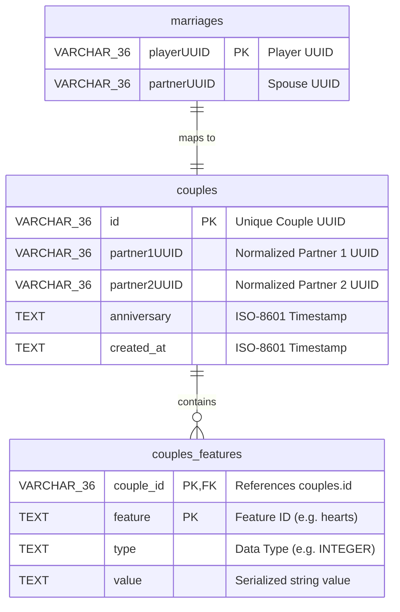

# Storage & Database Layer

The storage layer in **AllianceMarriage** provides database connection management using **HikariCP** and implements asynchronous persistence for couple relationships and dynamic attributes. It supports both **SQLite** and **MySQL**.

**English** | [Português (Brasil)](pt-br/storage-and-database.md)

---

## Database Schemas

`Database#createSchema()` verifies and creates three tables on startup:



### Table Details:
1. **`marriages`**: Stores 1:1 player mappings. Maps each player's UUID to their partner's UUID.
2. **`couples`**: Represents the relationship record. Contains anniversary timestamp, creation timestamp, and enforces `UNIQUE(partner1UUID, partner2UUID)`.
3. **`couples_features`**: Stores dynamic attributes as key-value pairs linked to `couple_id`.

---

## Connection Pool: `Database`
Located at: [`Database.java`](../core/src/main/java/net/joseplay/core/storage/Database.java)

Manages a **HikariDataSource** instance and provides asynchronous query execution wrappers.

### SQLite vs MySQL Configuration:
- When `PluginSettings#mysql()` returns `false`:
  - Connects to `plugins/AllianceMarriage/marriage.db` using the SQLite JDBC driver (`org.sqlite.JDBC`).
  - Sets maximum pool size to `1` to avoid file-lock contention in SQLite.
- When `PluginSettings#mysql()` returns `true`:
  - Connects via `com.mysql.cj.jdbc.Driver` using configured host, port, user, and password.
  - Sets maximum pool size to `8`.

### Core Execution Methods:

#### 1. Query Execution (`executeQueryAsync`):
```java
String sql = "SELECT anniversary FROM couples WHERE id = ?";

CompletableFuture<Optional<Instant>> future = database.executeQueryAsync(
    sql,
    resultSet -> {
        if (!resultSet.next()) {
            return Optional.empty();
        }
        return Optional.of(Instant.parse(resultSet.getString("anniversary")));
    },
    coupleId.toString()
);
```

#### 2. Update Execution (`executeUpdateAsync`):
```java
String sql = "UPDATE couples SET anniversary = ? WHERE id = ?";

database.executeUpdateAsync(sql, Instant.now().toString(), coupleId.toString());
```

---

## Couples Repository: `CouplesImpl`
Located at:
- Interface: [`CouplesRepository.java`](../core/src/main/java/net/joseplay/core/storage/CouplesRepository.java)
- Implementation: [`CouplesImpl.java`](../core/src/main/java/net/joseplay/core/storage/impls/CouplesImpl.java)

`CouplesImpl` implements in-memory caching to reduce database read calls during gameplay.

### Cache Structures:
```java
// Maps coupleId -> Couple instance
private final Map<UUID, Couple> coupleMap = new ConcurrentHashMap<>();

// Maps playerUUID -> coupleId
private final Map<UUID, UUID> playerCoupleMap = new ConcurrentHashMap<>();
```

### Partner Normalization:
To prevent duplicate records where player A is partner 1 in one row and partner 2 in another, UUIDs are sorted lexicographically:

```java
private UUID[] normalize(UUID partner1, UUID partner2) {
    if (partner1.toString().compareTo(partner2.toString()) <= 0) {
        return new UUID[]{partner1, partner2};
    }
    return new UUID[]{partner2, partner1};
}
```
Regardless of who initiates the marriage proposal, `partner1` is always the smaller UUID string, ensuring a single database row per couple.

---

## Feature Repository: `FeaturesImpl`
Located at: [`FeaturesImpl.java`](../core/src/main/java/net/joseplay/core/storage/impls/FeaturesImpl.java)

Manages database persistence for `couples_features`.

### Atomic SQL Increments:
When updating numerical features (`INTEGER`, `LONG`, `DOUBLE`), `FeaturesImpl` executes an upsert that performs addition at the SQL engine level:

#### MySQL Query:
```sql
INSERT INTO couples_features (couple_id, feature, type, value)
VALUES (?, ?, ?, ?)
ON DUPLICATE KEY UPDATE
    type = VALUES(type),
    value = CAST(couples_features.value AS SIGNED) + CAST(VALUES(value) AS SIGNED);
```

#### SQLite Query:
```sql
INSERT INTO couples_features (couple_id, feature, type, value)
VALUES (?, ?, ?, ?)
ON CONFLICT(couple_id, feature)
DO UPDATE SET
    type = excluded.type,
    value = CAST(couples_features.value AS INTEGER) + CAST(excluded.value AS INTEGER);
```

After the update executes, the method selects the updated value and writes it to the local cache.

---

## Developer Guidelines

1. **Avoid Blocking the Main Thread**:
   Do not call `.join()` or `.get()` on database futures from the Spigot primary thread. Use `thenAccept` or `thenCompose`:
   ```java
   couplesRepository.find(uuid1, uuid2).thenAccept(optionalCouple -> {
       // Callback executed when database returns
   });
   ```

2. **Reschedule Bukkit Calls**:
   When updating players or calling Bukkit API methods after a database operation, schedule the action onto the server thread:
   ```java
   couplesRepository.marryPlayer(p1, p2).thenAccept(result -> {
       Bukkit.getScheduler().runTask(plugin, () -> {
           Player player = Bukkit.getPlayer(p1);
           if (player != null) {
               player.sendMessage("Married successfully.");
           }
       });
   });
   ```
